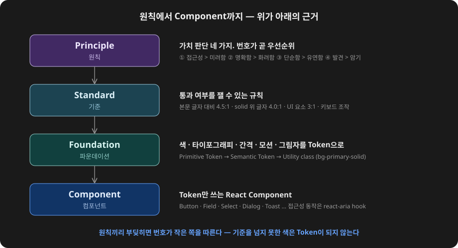
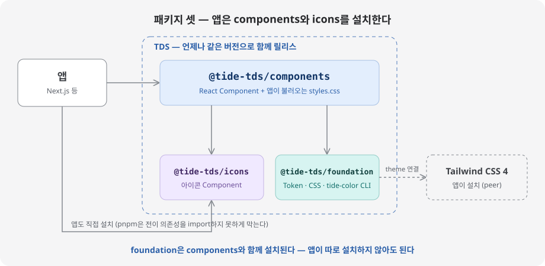
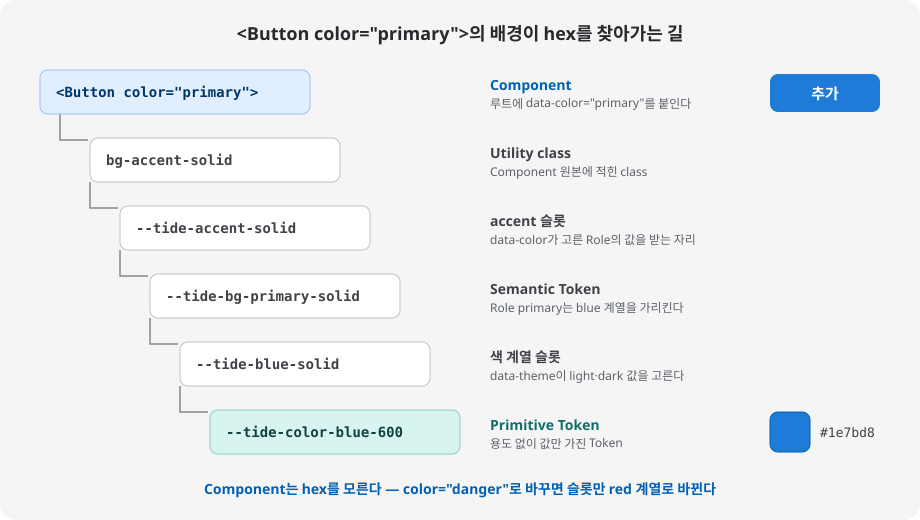
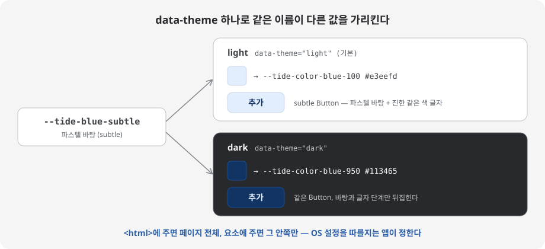

# Tide Design System

Tide는 원칙(Principle), 파운데이션(Foundation), 컴포넌트(Component) 세 층으로 이루어집니다.

- 문서(Storybook): https://tds.lakegreen.net
- 기술 스택: React 19, Tailwind CSS 4, react-aria, TypeScript

## 세 층

아래 층이 위 층의 근거가 됩니다. 원칙이 기준을 정하고, 기준을 통과한 값만 Token이 되며, Component는 Token만 씁니다.



### 원칙

번호가 곧 우선순위입니다. 원칙끼리 부딪히면 번호가 작은 쪽을 따릅니다.

| #   | 원칙                                    | English                     |
| --- | --------------------------------------- | --------------------------- |
| ①   | 접근성이 미려함보다 우선한다            | Accessible over beautiful   |
| ②   | 명확함이 화려함보다 우선한다            | Clarity over flair          |
| ③   | 단순함이 유연함보다 우선한다            | Simple over flexible        |
| ④   | 발견할 수 있음이 외워야 함보다 우선한다 | Discoverable over memorized |

자세한 내용은 [docs/principles](docs/principles/README.md), 측정 기준은 [docs/standards](docs/standards/)에 있습니다.

## 패키지

| 패키지                                           | 내용                                                             |
| ------------------------------------------------ | ---------------------------------------------------------------- |
| [`@tide-design/components`](packages/components) | React Component와 앱이 불러올 CSS(`styles.css`)                  |
| [`@tide-design/icons`](packages/icons)           | React 아이콘 Component(`PlusIcon`처럼 `Icon` 접미사)             |
| [`@tide-design/foundation`](packages/foundation) | Token, Tailwind 연결 CSS, 앱 브랜드 색을 만드는 `tide-color` CLI |

세 패키지는 언제나 같은 버전으로 함께 나갑니다.



## 시작하기

Next.js App Router 기준입니다. 자세한 안내는 문서의 「시작하기」에 있습니다.

준비: React 19, Tailwind CSS 4.3 이상과 Tailwind 플러그인(`@tailwindcss/postcss` 또는 `@tailwindcss/turbopack`).

**1. 설치**

```sh
pnpm add @tide-design/components @tide-design/icons
```

`@tide-design/foundation`은 components와 함께 설치됩니다. 아이콘을 쓰지 않으면 icons는 빼도 됩니다.

**2. 전역 CSS 두 줄**

```css
/* app/globals.css */
@import "tailwindcss";
@import "@tide-design/components/styles.css";
```

**3. 쓰기**

```tsx
import { Button } from "@tide-design/components";
import { PlusIcon } from "@tide-design/icons";

export default function Page() {
  return (
    <Button variant="solid" color="primary" startIcon={<PlusIcon />}>
      추가
    </Button>
  );
}
```

## 색과 Theme

Component는 hex를 직접 쓰지 않습니다. `<Button color="primary">`의 배경은 아래 순서로 값을 찾아갑니다.



light·dark Theme은 `<html>`(또는 아무 요소)에 `data-theme`을 주면 바뀝니다. 이름은 그대로 두고 참조하는 Primitive만 바꿉니다.



- Role은 뜻이 있는 색입니다. `neutral`, `primary`, `success`, `warning`, `danger`, `info` 여섯 개가 있고, 행동·의미 Component의 `color`로 고릅니다.
- 앱 브랜드 색은 `tide-color` CLI로 CSS를 만들어 Role로 더합니다. 그러면 `<Button color="brand">`처럼 씁니다.
- Tide는 OS 다크 모드 설정을 읽지 않습니다. 따를지는 앱이 정합니다.

## 저장소 구조

```text
packages/
  foundation/   Token과 CSS, tide-color CLI
  components/   React Component
  icons/        생성된 아이콘 Component
apps/
  docs/         Storybook 문서 앱 (npm에 내지 않음)
  smoke-next/   배포 패키지를 Next.js 앱에 설치해 보는 검사
docs/
  principles/   원칙
  standards/    측정할 수 있는 기준
  decisions/    ADR
  research/     리서치 기록
  progress/     작업 티켓
GLOSSARY.md     용어집
```

## 개발

Node.js 26(`.node-version`), pnpm이 필요합니다.

```sh
pnpm install
pnpm dev        # Storybook (http://localhost:6006)
pnpm test       # 단위 테스트와 story 테스트
pnpm typecheck
pnpm lint       # oxlint
pnpm format     # oxfmt
pnpm build
```

- 결정은 [ADR](docs/decisions/)로, 용어는 [GLOSSARY.md](GLOSSARY.md)에 남깁니다.
- 버전·changeset·릴리스 규칙은 [CONTRIBUTING.md](CONTRIBUTING.md)를 봅니다.

## 라이선스

[MIT](LICENSE)
